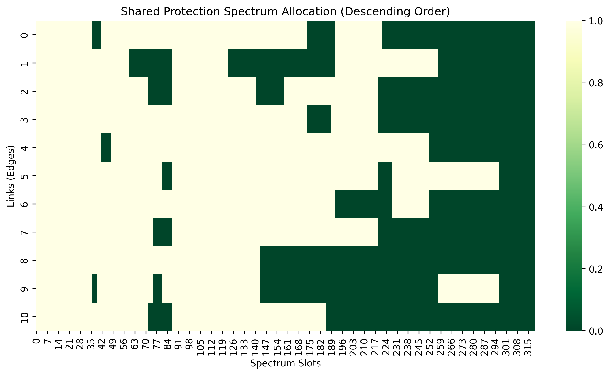

# Elastic Optical Network RMSA

A Python simulation for routing, modulation-format selection, spectrum assignment, and protection in elastic optical networks. It compares a baseline allocation strategy with simulated annealing, dedicated 1+1 protection, and shared protection using supplied network topologies and traffic matrices.

## Highlights

- K-shortest-path routing
- Distance-aware modulation selection
- Frequency-slot allocation and fragmentation metrics
- Simulated-annealing optimization
- Dedicated and shared path protection
- Spectrum heatmaps and performance comparisons

## Setup

```bash
python -m venv .venv
.venv\Scripts\activate
pip install -r requirements.txt
```

Run the main comparison:

```bash
python main_with_protection.py
```

`main.py` contains a smaller baseline-versus-optimization experiment. Input topology and traffic files are stored in `data/`. Generated plots and experiment folders are ignored; representative results are retained in `results/`.

## Example result



## Project note

This repository is a curated version of a team course project. The implementation and analysis were completed collaboratively; the repository does not claim sole authorship.
